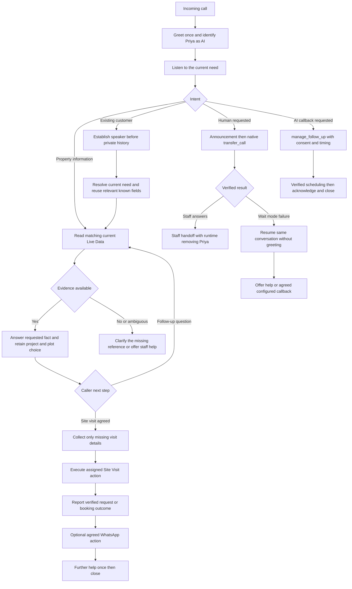
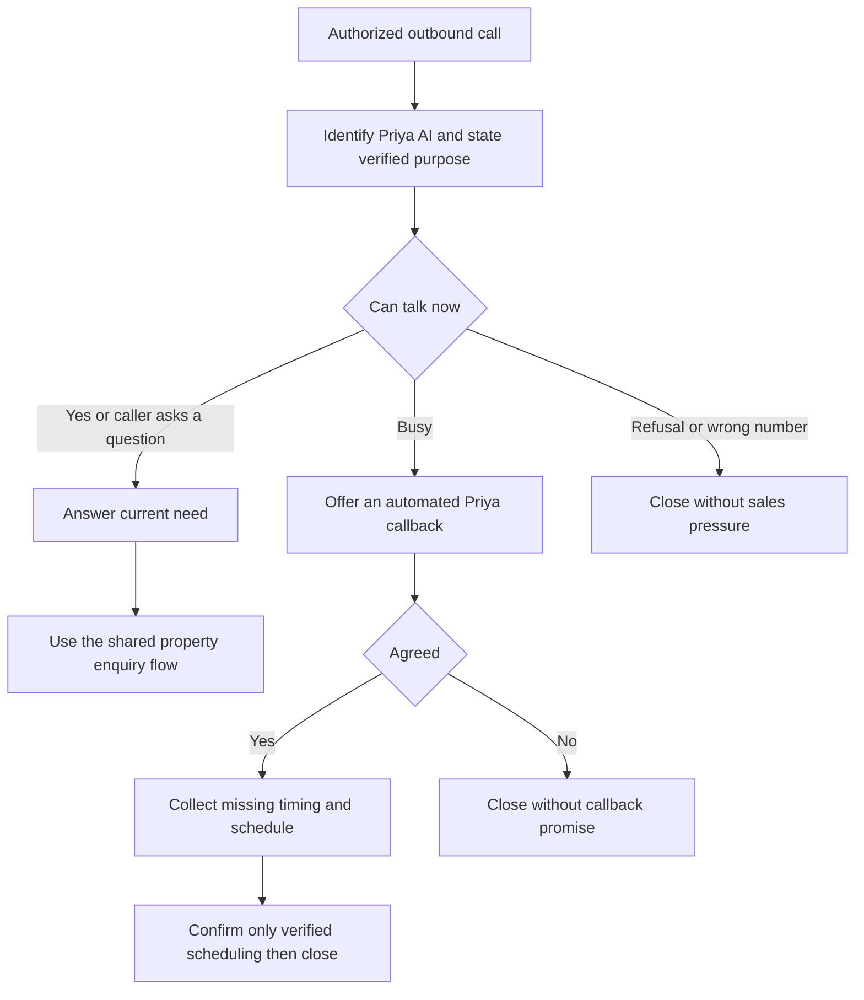

# New Royal Builders conversation flows

Priya is an AI assistant. Both directional prompts are standalone and use the property catalogue supplied as Live Data. This file explains expected behavior; it does not configure retrieval or connect external tools.

## Inbound

Refusal, wrong number and goodbye override intake. Immediate danger overrides sales. Direct transfer failure uses the configured runtime failure message and ending; it is not the wait-mode return branch.

## Outbound

## Example follow-up conversation

| Caller | Expected action |
| --- | --- |
| Unga kitta enna plots irukku | List distinct supported projects and areas from current Live Data; no mandatory qualification first. |
| Diamond City | Select that project; ask which detail if no question was stated. |
| Plot two sq.ft evlo | Answer only the current matching plot area; retain plot two. |
| Rate evlo | Use that project's plot two current amount, currency and basis; unclear source means seek confirmation. |
| Location enga | Use the selected project's place; do not ask project again. |
| Kumaran Garden pathi sollunga | Switch project, clear old plot choice, explain only supported details. |
| Naalaikku site paakkanum | Keep project selection; ask the next missing visit field. |
| Road size enna | Answer from current evidence, then continue the specific missing visit field. |
| Team kitta pesanum | Announce and execute native transfer without repeating consent or intake. |

## Returning caller examples

- Inbound with no current need stated: greet once, optionally acknowledge a general previous property discussion, then ask today's need. Do not reveal a prior budget/address/visit to an unestablished speaker.
- Inbound with need already stated: answer directly; do not ask what help is needed again.
- Outbound with verified follow-up purpose: mention the earlier property enquiry generally and ask whether they can talk. After agreement, resume only relevant pending work.
- Prior visit recorded: distinguish requested versus confirmed versus already completed. Do not create another visit unless the caller asks.
- Prior automated callback: acknowledge only an actual verified callback attempt, not merely a pending task.
- Someone else answers or says wrong number: do not reveal the saved customer's history. End politely and log only supported facts.

## Tools and prerequisites

| Tool or capability | Purpose and required setup |
| --- | --- |
| Live Data retrieval | Backend-supplied current facts; not a tool the prompt can force. Import sale inventory, not review or duplicate source rows. |
| Site Visit | Assigned external action for agreed site visit requests/bookings. Exact identifier, schema and outcome depend on agent configuration. |
| WhatsApp sharing | Assigned external action for approved photos/videos/maps to an agreed recipient. Exact identifier must come from attached tools. |
| transfer_call | Native live telephone transfer using agent settings, company-owned credentials, approved destination, mode and ring timeout. No destination arguments. |
| manage_follow_up | Automated Priya callback/reminder scheduling and cancellation with consent. Not a staff callback. |
| Optional staff callback action | Separately configured human follow-up; verified save and request ID required before promising it. |
| update_contact | Save the caller's own name with ownership and replacement evidence. |
| save_call_summary or automatic logging | Record verified outcomes once; use the actual configured mechanism. |

## Retrieval requirements and current limits

The existing backend performs a shared ranked Qdrant search for documents and Live Data rows, then reads up to two selected Live Data tables from PostgreSQL, up to 500 rows each. It sends current tables to the answer model. This works without a text KB when table indexing and retrieval succeed, but it does not guarantee the right table on every follow-up.

The prompts do not implement the previously proposed backend improvements. For dependable catalogue-wide answers, separately implement bounded inclusion of this small agent-owned catalogue or an independent Live Data lookup, preserve project/plot selection in trusted per-call state, and refresh current values each turn. Expose table retrieval diagnostics and source records. Do not load other companies' data or let caller text override tenant/agent scope.

Until that work is implemented, a follow-up with missing evidence must clarify or seek staff confirmation rather than reuse an old price. History windows and workflow retention are runtime settings, not guaranteed by writing "remember" in a prompt.
